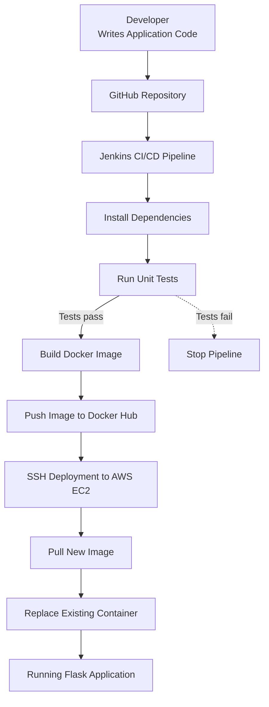

<div align="center">

# ⚙️ CI/CD FOR A WEB APPLICATION

### From Code Commit to Cloud Deployment — Automatically.

A complete DevOps project demonstrating automated testing, Docker image creation, registry publishing, and deployment to AWS EC2 using Jenkins.

<br/>


**Built by Vishwanath Veerapur**

</div>

---

## Overview

This project implements an end-to-end **Continuous Integration and Continuous Deployment (CI/CD)** workflow for a Python Flask web application.

When application code is pushed to GitHub, Jenkins can execute the pipeline to test the application, build a Docker image, push it to Docker Hub, and deploy the latest version to an AWS EC2 instance.

The objective is simple:

> **Automate the path from source code to a running application.**

### Project Highlights

- Automated pipeline execution using Jenkins.
- Python unit testing before deployment.
- Docker image creation and version tagging.
- Image publishing to Docker Hub.
- Remote deployment to AWS EC2 through SSH.
- Container replacement and running-state verification.
- Git-based source code management.

---

## Architecture



### Deployment Flow

| Stage | Responsibility |
|---|---|
| 01 — Source | Store and version application code in GitHub |
| 02 — CI | Jenkins checks out the repository |
| 03 — Test | Install dependencies and run unit tests |
| 04 — Build | Create a versioned Docker image |
| 05 — Publish | Push image tags to Docker Hub |
| 06 — Deploy | Connect to EC2 using SSH |
| 07 — Verify | Confirm that the new container is running |

---

## Technology Stack

| Technology | Purpose |
|---|---|
| Python | Application logic |
| Flask | Lightweight web framework |
| Git & GitHub | Version control and source repository |
| Jenkins | Pipeline orchestration |
| Python `unittest` | Automated testing |
| Docker | Application containerization |
| Docker Hub | Container image registry |
| AWS EC2 | Cloud deployment environment |
| Ubuntu Linux | Server operating system |
| SSH | Secure remote deployment |

---

## How the CI/CD Pipeline Works

### 01. Code Development

The developer modifies the Flask application and its corresponding unit tests.

### 02. Source Control

Changes are committed and pushed to the GitHub repository.

**Repository:** [CI-CD-for-Web-Application](https://github.com/Vishwa0456/CI-CD-for-Web-Application)

### 03. Jenkins Checkout

Jenkins retrieves the source code and starts executing the configured pipeline.

GitHub webhook triggering should be configured and verified separately.

### 04. Dependency Installation

Jenkins creates a Python virtual environment and installs the packages specified in `requirements.txt`.

```bash
python3 -m venv .venv-ci
. .venv-ci/bin/activate
pip install -r requirements.txt
```

### 05. Automated Testing

The pipeline executes the application's unit tests.

```bash
python -m unittest -v
```

If the tests fail, the pipeline should stop before building and deploying the new image.

### 06. Docker Image Build

Jenkins builds the application image and tags it using the build number and `latest`.

```text
vishwanath57/cicd-webapp:<BUILD_NUMBER>
vishwanath57/cicd-webapp:latest
```

Versioned tags help identify the image associated with a specific Jenkins build.

### 07. Docker Hub Publishing

The generated image is pushed to Docker Hub.

**Image repository:** [vishwanath57/cicd-webapp](https://hub.docker.com/r/vishwanath57/cicd-webapp)

### 08. AWS EC2 Deployment

Jenkins connects to the EC2 server using SSH and performs the deployment:

1. Pull the image corresponding to the Jenkins build.
2. Stop the existing application container.
3. Remove the old container.
4. Start the new container.
5. Verify that the container is running.

### 09. Live Application

The deployed Flask application responds with JSON containing the application name, version, and deployment message.

**Application endpoint:** [Open the Web Application](http://15.252.236.50:5000)

> Note: The endpoint depends on the EC2 instance being running, the application container being healthy, and the required network access being configured.

---

## Project Structure

```text
cicd-webapp/
│
├── app.py              # Flask application
├── test_app.py         # Automated unit tests
├── requirements.txt    # Python dependencies
├── Dockerfile          # Docker image instructions
├── Jenkinsfile         # CI/CD pipeline definition
└── README.md           # Project documentation
```

---

## Getting Started

### Prerequisites

Install or configure the following:

- Git
- Python 3
- Docker
- Jenkins
- AWS EC2 instance running Ubuntu
- Docker Hub account

### Clone the Repository

```bash
git clone https://github.com/Vishwa0456/CI-CD-for-Web-Application.git
cd CI-CD-for-Web-Application
```

### Run Locally

Create a virtual environment:

```bash
python3 -m venv .venv
source .venv/bin/activate
```

Install dependencies:

```bash
pip install -r requirements.txt
```

Run the tests:

```bash
python -m unittest -v
```

Start the application:

```bash
python app.py
```

### Run with Docker

Build the image:

```bash
docker build -t cicd-webapp .
```

Run the container:

```bash
docker run -d \
  --name cicd-webapp \
  --restart unless-stopped \
  -p 5000:5000 \
  cicd-webapp
```

Verify the running container:

```bash
docker ps
docker logs cicd-webapp
```

---

## Jenkins Configuration

The pipeline uses Jenkins-managed credentials rather than hardcoded secrets.

| Credential ID | Purpose |
|---|---|
| `dockerhub-credentials` | Docker Hub authentication |
| `ec2-deploy-key` | SSH authentication to EC2 |

The Jenkins environment must have the required Git, Python, Docker, and SSH Agent capabilities configured.

**Security rule:** Never commit private keys, passwords, access tokens, or other secrets to GitHub.

---

## Validation & Results

The project has successfully demonstrated the following workflow:

- Unit tests passed.
- Docker image built and tagged.
- Image pushed to Docker Hub.
- New image pulled on the EC2 server.
- Existing application container replaced.
- New application container verified as running.
- Flask application updated to version `1.1`.

Example response:

```json
{
  "application": "CI/CD Web Application",
  "version": "1.1",
  "message": "Version 1.1 deployed automatically through Jenkins CI/CD!"
}
```

---

## Troubleshooting

<details>
<summary><strong>Jenkins pipeline fails</strong></summary>

Review the Jenkins Console Output. Verify repository configuration, credentials, and the availability of required tools.

</details>

<details>
<summary><strong>Unit tests fail</strong></summary>

Run `python -m unittest -v` locally and resolve failing assertions before deploying.

</details>

<details>
<summary><strong>Docker build or push fails</strong></summary>

Check Docker availability, image tags, Docker Hub authentication, and Jenkins credential configuration.

</details>

<details>
<summary><strong>SSH deployment fails</strong></summary>

Verify the EC2 instance state, SSH private-key credential, username, network connectivity, and security group rules.

</details>

<details>
<summary><strong>Application is inaccessible</strong></summary>

Check `docker ps`, `docker logs cicd-webapp`, the Flask listening port, and EC2 inbound network rules.

</details>

---

## Security & Reliability Improvements

The following improvements are recommended before production use:

- Exclude README-only changes from expensive Docker build and deployment stages.
- Restrict inbound access to the application port.
- Use HTTPS through a reverse proxy or load balancer.
- Add container health checks and automated rollback.
- Scan Docker images for known vulnerabilities.
- Use Terraform to manage cloud infrastructure.
- Add Prometheus and Grafana for monitoring and observability.
- Use immutable image tags for reliable releases.

---

## Roadmap

- [ ] Verify automatic GitHub webhook triggering.
- [ ] Skip Docker build and deployment for documentation-only changes.
- [ ] Add Docker image security scanning.
- [ ] Implement health checks and rollback.
- [ ] Provision infrastructure using Terraform.
- [ ] Add monitoring with Prometheus and Grafana.
- [ ] Configure HTTPS for the application.

---

<div align="center">

### Built to Learn. Automated to Deploy.

**Vishwanath Veerapur**  
DevOps | Cloud Computing | CI/CD | AWS

[GitHub Repository](https://github.com/Vishwa0456/CI-CD-for-Web-Application) · [Docker Hub](https://hub.docker.com/r/vishwanath57/cicd-webapp)

</div>

